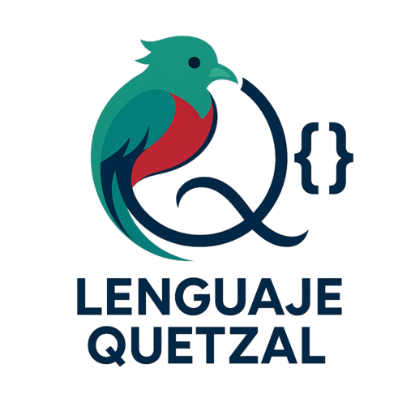

# Lenguaje Quetzal for Zed



Language support for [Lenguaje Quetzal](https://github.com/AntaresGT/lenguaje-quetzal) in [Zed](https://zed.dev), built on the existing [Tree-sitter Quetzal grammar](https://github.com/AntaresGT/tree-sitter-quetzal).

## Features

- Automatic `.qz` file association with Quetzal.
- Tree-sitter syntax highlighting using Zed-supported captures.
- Unicode identifiers and accented Quetzal keywords.
- Bracket matching, syntax-aware indentation, and code outline.
- Function, method, constructor, object, and prototype navigation.
- Vim text objects for functions, classes, and comments.
- Language-scoped snippets for official Quetzal syntax.
- Line and block comment highlighting.
- Optional light and dark **Quetzal Icons** theme with a dedicated `.qz` file icon.
- Diagnostics, completion, hover, and go-to-definition through the official `quetzal-lsp` when it is installed.

The extension does not execute Quetzal code or bundle the language server. It looks for `quetzal-lsp` on `PATH` and starts it with `--stdio`. Without that executable, syntax highlighting, indentation, outline, and snippets remain available, but LSP features are not.

## File icons

After installing or reinstalling the dev extension, open Zed's icon theme selector and choose **Quetzal Icons**. The extension does not change your current icon theme automatically. Both appearance variants use the same transparent PNG asset; other file types retain Zed's fallback behavior.

## Installation

1. Open Zed's **Extensions** page.
2. Select **Install Dev Extension**.
3. Choose this repository's directory.
4. Wait for Zed to compile the extension and the pinned grammar.
5. Open a `.qz` file and confirm that **Quetzal** is the active language.

Zed may download `wasi-sdk` and install the Rust `wasm32-wasip2` target. To enable LSP features, install the official server from the Quetzal repository with `cargo install --path crates/lsp` and make sure `quetzal-lsp` is on `PATH`. The Quetzal interpreter is not required. See [the development installation guide](docs/instalacion-desarrollo.md) for troubleshooting and validation instructions.

## Example

```quetzal
vacio saludar(texto nombre) {
    si (nombre != "") {
        consola.mostrar(t"¡Hola, {nombre}!")
    } sino {
        consola.mostrar("¡Hola, Quetzal!")
    }
}
```

## Snippets

The snippet prefixes are `si`, `mientras`, `para`, `paracada`, `hacer`, `funcion`, `objeto`, `prototipo`, `intentar`, `importar`, `exportar`, `asincrono`, and `esperar`. Function snippets generate typed declarations; `funcion` is only a prefix, not a Quetzal keyword.

## Compatibility

- Manifest schema: 1.
- Locally audited Zed version: 1.26.2 on Linux.
- Grammar version: 0.1.0, Tree-sitter ABI 15.
- Pinned grammar revision: `769de1c803cb00ba9863bb68735caf306d7857a1`.

Automated parser and query checks are recorded in [`pruebas/resultados.md`](pruebas/resultados.md). Visual and interactive behavior in Zed remains subject to the manual checks listed there; automated Tree-sitter validation is not a substitute for testing the editor integration.

## Desarrollo y pruebas

La documentación técnica y las pruebas están en español:

- [Instalación de desarrollo](docs/instalacion-desarrollo.md).
- [Compatibilidad y decisiones](docs/compatibilidad.md).
- [Matriz de pruebas](pruebas/matriz-pruebas.md) y [resultados](pruebas/resultados.md).
- [Publicación manual](docs/publicacion-manual.md).

La validación estática básica no requiere dependencias externas:

```bash
python3 pruebas/validar.py
```

Para comprobar también los nodos contra una descarga de la revisión fijada:

```bash
python3 pruebas/validar.py --gramatica /ruta/a/tree-sitter-quetzal
```

## Reporting issues

Include the Zed version, operating system, a minimal `.qz` example, the expected behavior, and the relevant output from **zed: open log**. Do not include credentials or private source code. Parser grammar discrepancies should be reproduced against the pinned Tree-sitter revision before reporting them to the grammar repository.

## License and attribution

This extension is licensed under the [MIT License](LICENSE).

The Tree-sitter grammar is developed by AntaresGT and declares the MIT license in its `tree-sitter.json` and `package.json`. The extension references its generated parser at a fixed revision; it does not duplicate or reimplement the grammar.
